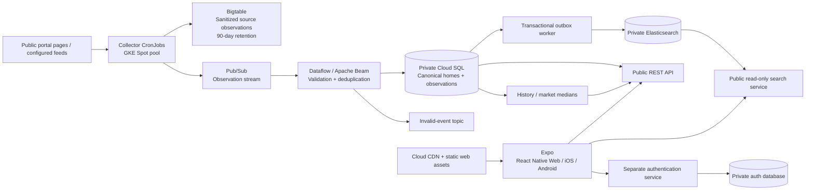

# Architecture and operational boundaries

This repository contains a working rental discovery app and an undeployed cloud configuration. Source access, production credentials, native signing, and production load/availability verification are separate prerequisites. No infrastructure was applied and nothing was pushed.

## Service ownership

| Service | Responsibility | Production access |
| --- | --- | --- |
| API | Public property reads, history, favorites, saved searches, reports | Rental reads; writes to account-owned rental tables |
| Auth | Argon2 password hashing, one-hour RSA JWT issuance | Auth database only; JWT signing key |
| Search | Validated search parameters translated to Elasticsearch queries | Read-only index API key |
| Collector | Portal discovery/parsers, feeds and JSON-LD URLs, oldest-first rechecks | Bigtable and the observation topic; no SQL identity |
| Dataflow | Normalize, conservatively merge, keep observations and recompute signals | Rental writer identity |
| Indexer / retention | Deliver SQL outbox; expire old contact fingerprints and stale source status | Rental maintenance identity; index writer key |

Bigtable is a source archive and recheck-state store. Cloud SQL is the canonical store. The public search endpoint is backed by Elasticsearch, but neither arbitrary query DSL nor port 9200 is exposed to the internet. Auth and rental data use separate databases and IAM users on the same initial Cloud SQL instance.

## Identity and consistency

An exact source key is `(source, external_id)`. Cross-source matches require the same building address, compatible area and room count, non-conflicting floor, and a corroborating phone fingerprint or image URL. Coordinates, when provided, must be within 100 m. A phone alone never merges homes. This deliberately misses uncertain duplicates. Two genuinely distinct, otherwise identical units in the same building can still be ambiguous; a human merge/split review console is a follow-on requirement.

Dataflow processes at-least-once events. A deterministic receipt, source update, canonical update, observation, and outbox insert commit in one database transaction. PostgreSQL advisory locks serialize canonical decisions within a city. Older/equal observations cannot overwrite newer state. Transient SQL errors are retried by Dataflow; invalid messages go to a dead-letter topic as hashes and error codes, not raw contact details. A single indexer reads the current canonical document when retrying an outbox event. Do not scale the indexer beyond one replica without adding per-property index versioning/locking.

Gratka/Morizon cross-posts may also match on their shared internal listing ID plus agreeing city, street, area and rooms, with no conflicting floor/location. The private syndication key is excluded from public serialization.

Each source keeps its own price, commission and status. The displayed canonical record prefers an active source declared private, then the most recent observation. “Private” is a source assertion, not a verified identity. A property remains active while any source is active; missing feed entries and transport errors are not treated as removals. Seven days without a successful observation makes a source unknown. The cloud CronJob/optional worker loop runs every six hours by default; bounded runs do not guarantee every stored advert is revisited in that interval. Local `make collect` is one-shot. Bigtable stores an oldest-first recheck index; SQL supplies the equivalent ordering locally. Collection reports distinguish partial failures from budget-limited successful runs.

## Privacy and risk signals

Polish phone numbers are normalized then HMAC-SHA256 hashed with a secret key before entering Bigtable, Pub/Sub or SQL. The public API/index never includes phone hashes. Phone-like numbers are stripped from public titles/descriptions. Existing text may still contain other personal details supplied by a source; full content moderation/redaction is not implemented. Access to source payloads stays private.

Signals include the same contact on at least three distinct active properties within 90 days, inconsistent agency/private declarations, commission on a private offer, and differing source prices. Every signal carries an explanation. Reports are stored separately and never automatically become accusations. Hashes are pseudonymous evidence, not anonymous data. The 90-day retention job and Bigtable GC reduce retention; production needs an operator-reviewed deletion/rectification process, key rotation and source terms review.

## Historical methodology

Charts measure advertised base rent, not completed contracts. For each calendar month with observations, take each source's latest observation, retain active source observations, then select the latest price for each canonical property. Compute median base rent and median rent per m² over those properties. This avoids counting duplicates multiple times. It does not carry observations forward into unobserved months, control for changing property mix, or estimate a representative city-wide rental index. Results include sample size and demo status. City, district and region filters are supported by the API; the current UI exposes city and district.

## Infrastructure and availability

The default region is Warsaw (`europe-central2`), with one zone (`europe-central2-a`). There is one on-demand `e2-standard-4` core node and a separate Spot pool scaled from zero to two nodes. Cloud SQL and Bigtable each have their own single-zone capacity; Dataflow is managed outside GKE. This is not an architecture with only one billed VM/service.

Terraform configures private GKE nodes/control plane, VPC-native pod ranges, Private Google Access, NAT, a fleet membership, Workload Identity, private Cloud SQL with IAM authentication and point-in-time recovery, a 90-day Bigtable archive, Pub/Sub retention, an optional Flex Template Dataflow job, Artifact Registry, per-service secret containers, Cloud CDN and an HTTPS endpoint for static web assets, Cloud Armor throttling, and optional readiness-based uptime monitoring with a 95% rolling 30-day SLO.

The API uses short bounded requests, readiness/liveness probes and SQL search fallback. Pod disruption budgets and surge updates reduce voluntary disruption, but one node and one zone remain single points of failure. A 95% target allows about 36 hours of unavailability over 30 days. It is a monitoring objective, not a proven application SLA. GKE's [published SLA](https://cloud.google.com/kubernetes-engine/sla) covers the zonal control plane at 99.5%; it does not guarantee application pods or this entire dependency chain. Upgrade to multiple regular nodes, multiple zones, regional SQL, and replicated Elasticsearch before committing to stronger availability.

## References checked during implementation

- [GCP regions and zones](https://docs.cloud.google.com/compute/docs/regions-zones)
- [GKE SLA](https://cloud.google.com/kubernetes-engine/sla)
- [OLX Partner API](https://developer.olx.pl/api/doc): account-scoped partner advert management, not evidence of a public bulk marketplace feed.
- [OLX Group Developer Hub](https://developer.olxgroup.com/): Otodom real estate integrations.
- [Gratka WebAPI](https://webapi2.gratka.pl/): registered partner access; published documentation must not be assumed to provide rental-wide data access.
- [Expo documentation](https://docs.expo.dev/): web/native architecture; actual compatible package versions were checked against Expo's installed SDK manifest.
