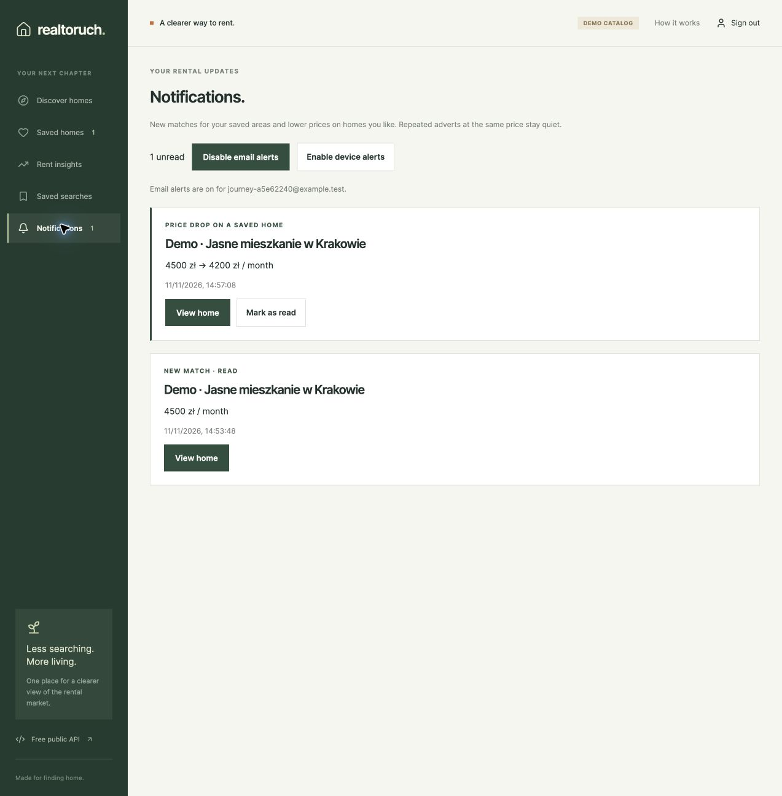
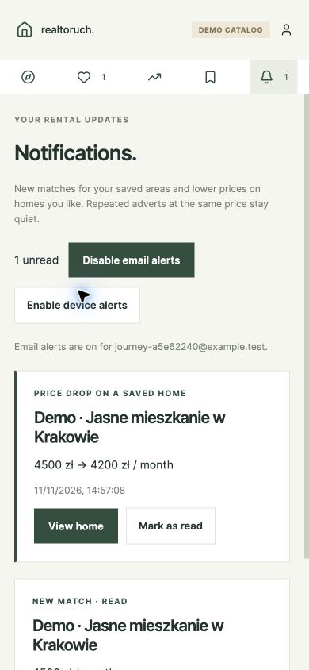
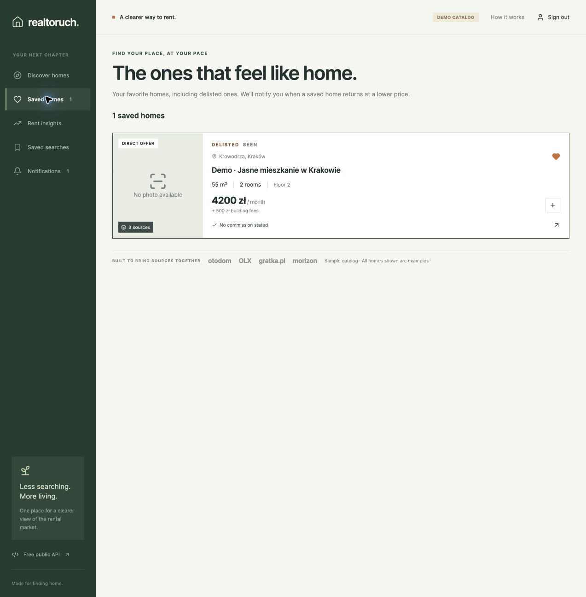
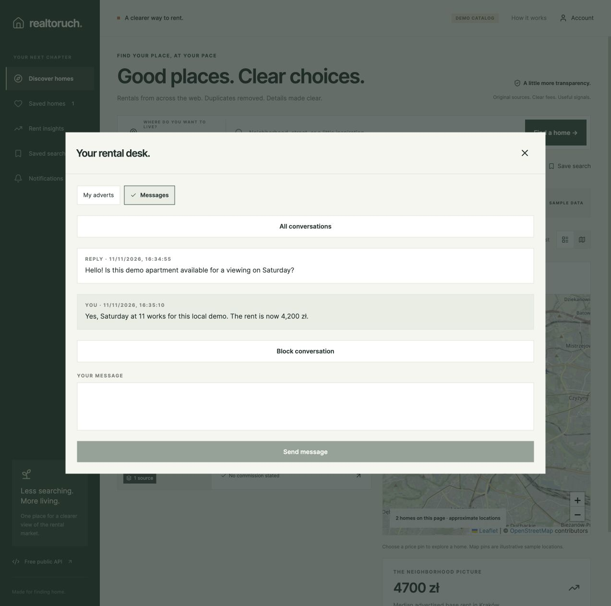
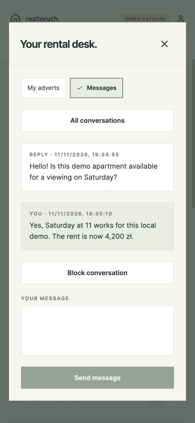
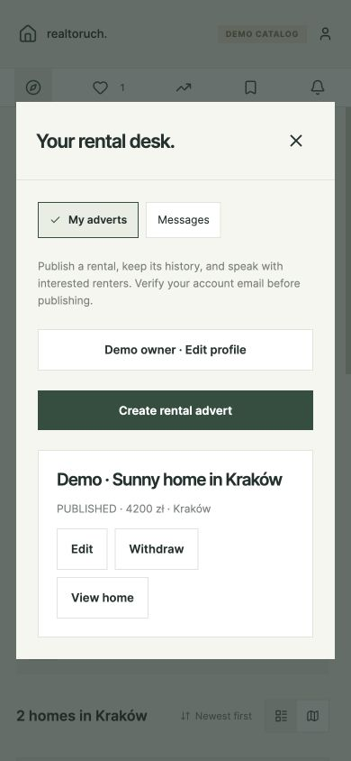
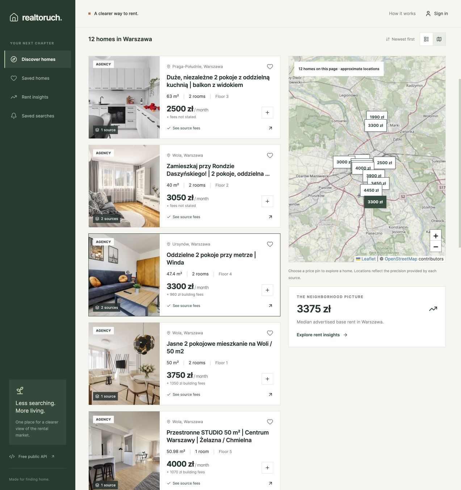
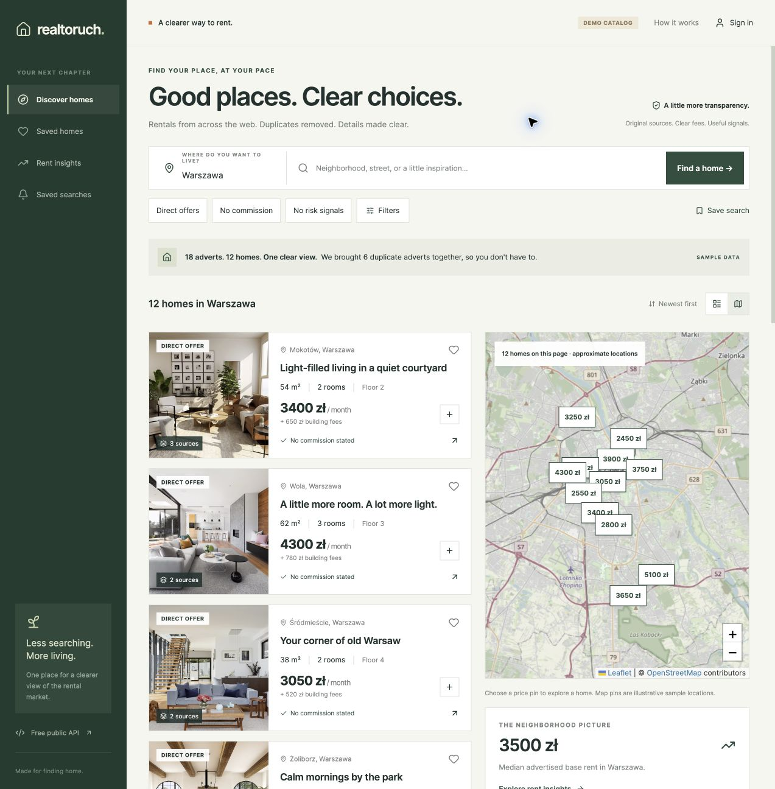

# Verification record

## Integrated candidate — 12 November 2026

Status **LOCAL_PARTIAL**, candidate `a17cf16f4e6c3c33d629684fd6a75685eb147b53`. Checks passed: 392 offline Python tests (115 explicit service-only skips), 240 real PostgreSQL/Elasticsearch tests with zero skips, 122 frontend unit tests, strict TypeScript and 36 production-browser cases with zero skips. [Hosted CI](https://github.com/alex-noel/realtoruch/actions/runs/43119698856) passed all four jobs on application-identical `d56ae2313f34c574877e16050ea3affd67b064b6`, including native JS exports and dependency audit; the final grant/test follow-up passed the full current service profile. Exact compatible revisions are recorded in the report. No cloud deployment was performed; the user explicitly authorized the GitHub push.

The 72-hour soak remains incomplete and its immutable pin predates the final parser/identity changes. Automatic OLX collection, installed-device acceptance, external inbox/push delivery and deployed infrastructure/SLA remain open. Current counts, UTC times, fixes and all limitations are in [release readiness](release-readiness.md), [T32 evidence](verification/T32-evidence.json) and the [core acceptance index](verification/core-acceptance.json).

## Historical pre-sprint verification — 11 November 2026

The records and screenshots below describe earlier bounded checks and catalog snapshots. Their test counts, bundle sizes and source results are historical; the dated integrated summary above is authoritative. No Git push had occurred at the time of these earlier checks.

| Check | Result |
| --- | --- |
| Python integration/unit suite | 132 passed with PostgreSQL/Elasticsearch enabled; default run has 127 passing and five service tests skipped; one upstream TestClient deprecation warning |
| TypeScript strict check | Passed on 11 November |
| Expo production web export | Passed on 11 November |
| Expo iOS/Android Hermes bundle exports | Passed for both platforms on 11 November (about 2.1 / 2.2 MB); not a signed native build or device test |
| Terraform 1.13.5 + Google / Google beta 6.50.0 | `fmt` and `validate` passed on 11 November; no plan/apply |
| Helm 3.19 lint/template rendering | Passed on 11 November: 31 resources with collector off, including auth-worker and its private cleanup network policy |
| Docker Compose | Configuration validated; isolated PostgreSQL 16 and Elasticsearch 8.19.6 containers started for service integration tests, then stopped |
| PostgreSQL migrations / roles | Numbered migrations through 004 rentals/auth applied; current grants applied to isolated service roles. Registration, publishing/editing, favorites, messages and hide/restore exercised with those roles. Cloud SQL IAM remains unverified |
| Local restore rehearsals | SQLite live catalog/auth restored with integrity/FK/count checks; PostgreSQL rental/auth custom dumps restored into fresh databases with matching table counts and sorted row-content digests |
| Bounded local load | 200/200 HTTP 200 responses, concurrency 8; median 56.5 ms, p95 130.4 ms, 142.6 requests/s over 1.402 s. Local throttle raised for this loopback rehearsal only; not production capacity or an SLA |
| Email / push transport | Confirmation, unsubscribe, retry/cancellation and email-file tests passed; actual SMTP protocol tested against a local socket receiver; Web Push payload encryption verified |
| Optional GCP/Dataflow dependencies | pip dry-run resolved successfully on 7 November; managed Dataflow execution not tested |
| Public/secret boundary | No phone hashes in public listings; ES stays ClusterIP; `/internal` excluded from ingress |

## Eight-step rental journey — 11 November

The browser ran the production web export against the local auth/API services and a separate background alerts process. Synthetic lifecycle events were injected with `scripts/journey.py` into a separate database; real listings were never marked inactive or repriced for the test.

1. Selected Kraków, rent **below** 5,000 PLN, minimum 50 m² and direct offers, drew an area, and saved the search. Reopening Saved searches restored the polygon and filters.
2. Enabled email alerts, opened the locally generated confirmation email link, and saw successful confirmation in the app.
3. Inserted a matching 55 m² home at 4,500 PLN. The worker produced one inbox notification and one email preview.
4. Opened it and saved it. Its card displayed **SEEN**, the notification became read, and Saved homes contained it.
5. Delisted it: the saved card displayed **DELISTED**, while the filtered discovery list/map had zero results/pins.
6. Relisted under a different advert ID at 4,500 PLN: the canonical ID stayed the same, unread count stayed zero, and no rental email was added.
7. Relisted at 4,200 PLN: exactly one **PRICE DROP ON A SAVED HOME** notification and email were produced, showing 4,500 → 4,200 PLN.
8. Delisted again: Saved homes retained the seen/delisted home at the last price; discovery/map again had zero matches.

The email queue contained exactly three sent local previews: confirmation, first match and lower price. These were local `.eml` files, not delivery to an external mailbox. The phone viewport check at 390 × 844 showed the notification controls/cards without horizontal overflow. The final browser console check had no errors or warnings.

The PostgreSQL tests apply the actual numbered migrations, repeat the full API/alert journey, and test an ingestion/indexer acknowledgement race. A real Elasticsearch query confirmed polygon/exclusive-price matching and removal of inactive homes. The emulated AMD64 ES image initially failed its seccomp startup check on Apple Silicon; the native ARM64 image ran successfully without disabling protections.

## Accounts, publishing and messages — 11 November

Chrome used the rebuilt production web export and separate API/auth/background workers. A synthetic account's local verification email opened successfully, and the HttpOnly-cookie session survived reload. The account panel showed verified status and labelled device sessions.

Through the UI, the owner created a profile, saved a 55 m² Kraków draft with a map pin, and published it at 4,500 PLN plus 500 PLN fees. Editing it to 4,200 PLN preserved both prices in detail history. Opening marked it seen; saving and withdrawing retained a **DELISTED** favorite while discovery/map lost the home. Republishing retained its canonical identity. A second verified test account sent a local-only enquiry; the owner inbox showed one unread message, opening read it, and replying displayed both messages. No messages were sent to actual advertisers.

At 390 × 844, the inbox and all advert-editor fields fit within the viewport; body/dialog width was 390 px, without horizontal overflow. Temporary viewport overrides were reset. The marketplace is lazy-loaded as a separate approximately 14 KB web chunk.

Tests additionally exercise single-use/expired recovery links, mail retries, refresh replay, per-device revocation, account deletion retries, private conversation access, message retry deduplication and blocking, stale edit rejection, moderation appeals, and merge/split preservation of favorites/seen/history. Merge and publishing were also tested on PostgreSQL. A versioned-migration PostgreSQL query issue in public profiles was corrected and the integration rerun passed.

## Live Kraków collection — 11 November

Otodom, Gratka and Morizon each contributed 18 adverts: **54 source adverts merged into 41 canonical homes**, including eight declared private offers. Two real offers matched the selected price/size/private filters and the drawn area in the browser. These bounded samples do not establish full-market coverage or verify owner identity.

The second concurrent run checked 12 new adverts per provider and skipped six fresh ones each, with no reported errors. A recheck-only run while all records were still fresh finished with zero outbound requests and no extra history rows. Unit tests separately cover city scoping, freshness budgets, daily unchanged checkpoints, idempotency and concurrent search delivery.

Three further bounded live reliability cycles ran from 15:11:20 to 15:13:52 UTC. Otodom, Gratka and Morizon all succeeded in all three, adding 18 observations total. Each cycle took about 31 seconds with up to two new details per provider; fresh discoveries were skipped. The durable run records expose sanitized health/backoff. This is short-run evidence, not multi-day unattended reliability.

OLX's ordinary public search/detail page was readable in Chrome without an account. A parser extracted a real Kraków listing's 2,550 PLN rent, 450 PLN fees, 53 m², two rooms, declared private status and approximate map position. Its limited public HTML capture was imported into the live catalog, and synthetic regression fixtures cover the shape. Robots/search still returned HTTP 403 to the scheduled HTTP client; automatic OLX collection remains disabled. No account or session-cookie transport was used.

The final live catalog at this verification contains **66 canonical homes / 89 source adverts / 112 observations**: 54 homes in Kraków and 12 in Warszawa; 30 Otodom, 29 Gratka, 29 Morizon and one manually captured OLX advert. All real data/captures remain ignored local artifacts. The earlier counts above describe earlier snapshots, not current totals.

## Earlier live Warszawa checks — 11 November

Bounded collection from the public Warszawa rental pages of Otodom, Gratka and Morizon succeeded. Each connector checked robots rules and paced requests. All three search parsers discovered listings on pages one and two, including links to the next page. This is a sample check, not a complete inventory of those portals.

- The Warszawa portion of the live SQLite catalog contains **16 source adverts merged into 12 homes**, with no demo records: six Otodom, five Gratka and five Morizon adverts. Four Gratka/Morizon cross-posts merged using their shared internal identity and compatible property details.
- A final recheck visited all 16 stored adverts with zero reported collection errors. The catalog contains 39 observations, including an Otodom base-rent change from 3,500 to 3,300 PLN. Ten source adverts have private contact fingerprints; public listing responses exclude those fingerprints and source syndication keys.
- Chrome showed the real homes as a list and map. The direct-offer filter returned four homes. A merged Gratka/Morizon home displayed both source links, 15 gallery images, its stated 960 PLN monthly fee and a 4,260 PLN monthly total. The last gallery image loaded, and all gallery controls wrapped within the dialog.
- The market API returned a 3,375 PLN median for the 12 homes. Live history currently starts with these November observations; the demo's fictional past months are absent from the live database.
- At this earlier check, OLX returned HTTP 403 and had no verified parser. The later browser/parser check above supersedes that parser status; automatic HTTP access is still blocked.

Fixture and integration tests cover explicit removal, parser failure, throttling, changed rent, bounded discovery, robots wildcard rules, conflicting duplicate evidence and private-data boundaries. Simulated Bigtable/Pub/Sub tests verify that a failed publication does not advance recheck state. Portal removals, throttling and cloud failures were tested with controlled responses, not induced on live services. Sanitized fixture provenance is recorded in [the fixture README](../backend/tests/fixtures/portals/README.md).

## Demo browser checks — 7 November

The running application was checked in Chrome at desktop size and a 390 × 844 phone viewport:

- Synthetic catalog rendered 12 canonical homes from 18 source adverts, with source links and clearly marked demo state.
- Private-offer + no-risk filtering reduced the result set to seven homes.
- Property comparison showed each home's base rent, fees, deposit, commission, dimensions, advertiser and sources.
- Rent insights displayed six observed months, per-month sample sizes and methodology.
- A 3,000 PLN maximum yielded three homes; map pins matched that filtered result set.
- Tapping a repeated-contact example opened its gallery, source/fee details, price history and non-accusatory signal explanation.
- Narrow-screen filter overflow was found and corrected; tablet map switching and initial map bounds were corrected.
- A React Native empty-text conditional warning found in dialog inspection was corrected; the final static production bundle was checked with no new dialog errors.

## Performance and dependencies

Importing individual icons reduced the main web bundle from about 3.1 MB to about 597 KB uncompressed in the current build. Leaflet loads as a separate approximately 149 KB chunk; the advertiser/moderation desk adds a lazy 14 KB chunk. These are build sizes, not measured Core Web Vitals or a latency SLA. The UI requests at most 24 homes per page and avoids external font loading. Conversation lists batch advert and unread-count reads instead of one query per thread.

The project was moved to the compatible Expo 58 / React 19.3 / React Native 0.88 package set. The latest audit run after that upgrade showed **zero high/critical** and five moderate findings associated with Expo's development-time `glob`/`minimatch` dependency chain. No forced incompatible downgrade or global major override was applied. Keep these toolchain dependencies under review before release. Python requirements are pinned for the tested base runtime and development environment; cloud extras have bounded versions and were dependency-resolved, not fully exercised.

## Not verified

- Automatic OLX HTTP collection, full-market coverage or geography outside the configured Kraków/Warszawa searches. One manual OLX import and public-page parser are verified.
- Unattended collection over an extended period, live removal detection and portal changes beyond the captured fixtures.
- Production GCP permissions/quotas, Cloud SQL IAM, TLS issuance, Cloud CDN, and long-running deployment behavior. Local PostgreSQL/Elasticsearch integration is verified.
- A real Dataflow streaming job or Spot interruption/recovery.
- Real SMTP-provider/inbox delivery and real browser/Expo push-provider delivery. Production SMTP and native push credentials have not been supplied.
- Signed iOS/Android apps, native map credentials, physical-device behavior or app-store delivery.
- Production load capacity, a 30-day 95% availability result, Cloud SQL point-in-time recovery or production security certification. Bounded local load and SQLite/PostgreSQL restore rehearsals passed.

The [feature ledger](feature-status.md) identifies further product scope, including media uploads, billing, richer advertiser tools and production delivery prerequisites. This verification record should not be interpreted as complete Otodom parity or production acceptance.
